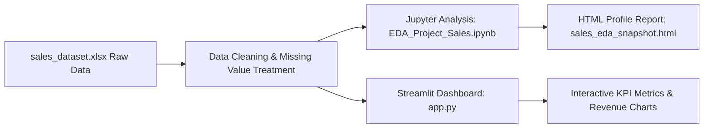

# 📈 Retail Sales Exploratory Data Analysis & Analytics App

[](https://github.com/Aniket-Gund/EDA_Sales_Project/stargazers)
[](https://python.org)
[](https://streamlit.io)
[](https://pandas.pydata.org/)
[](LICENSE)

An exploratory data analysis and interactive Streamlit web dashboard analyzing retail sales datasets. Features sales trend forecasting, regional demand patterns, customer demographics, and product revenue contributions.

---

## 🌟 Key Features

- **📊 Comprehensive Visual Reports**: Time-series sales trend curves, profit margins across product categories, and regional revenue maps.
- **📄 Interactive HTML Profiling**: Includes `sales_eda_snapshot.html` for offline interactive exploration.
- **🌐 Streamlit Application**: Live web dashboard for dynamic filtering by date range, product line, and sales region.
- **📓 Jupyter Notebook**: Step-by-step EDA methodology documented in `EDA_Project_Sales.ipynb`.

---

## 🏗️ Data Architecture



---

## 📂 Repository Structure

```
EDA_Sales_Project/
│
├── EDA_Project_Sales.ipynb  # Interactive Jupyter notebook with statistical figures
├── app.py                   # Streamlit web analytics dashboard
├── eda_project_sales.py     # Standalone data analysis script
├── sales_dataset.xlsx       # Primary Excel sales transaction records
├── sales_eda_snapshot.html  # Standalone interactive HTML profiling report
├── requirements.txt         # Dependencies
└── README.md                # Project documentation
```

---

## 🚀 Getting Started

```bash
git clone https://github.com/Aniket-Gund/EDA_Sales_Project.git
cd EDA_Sales_Project

python -m venv venv
venv\Scripts\activate    # Windows
source venv/bin/activate  # macOS/Linux

pip install -r requirements.txt
streamlit run app.py
```

---

## 👨‍💻 Author

**Aniket Gund**
- GitHub: [@Aniket-Gund](https://github.com/Aniket-Gund)
- LinkedIn: [Aniket Gund](https://www.linkedin.com/in/aniket-gund/)

---

## 📄 License

Distributed under the [MIT License](LICENSE).
